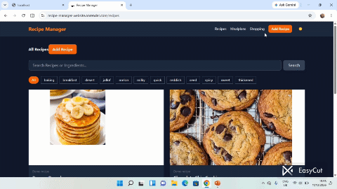

# Recipe Manager

A full-stack recipe manager for collecting recipes, planning meals for the week, and building a combined shopping list from selected recipes.



## Features

- Browse, search, and filter recipes by tag
- Create, edit, and delete your own recipes
- Save ingredients, quantities, units, preparation and cooking times, servings, steps, tags, and images
- Upload recipe images to Cloudinary
- Plan recipes across the days of the current week
- Generate a shopping list by combining matching ingredients and units from selected recipes
- Browse seeded demo recipes
- Keep recipes and meal plans scoped to a visitor using a signed browser cookie

## Tech Stack

- Node.js and Express 5
- MongoDB with Mongoose
- EJS templates with `ejs-mate` layouts
- Tailwind CSS
- Cloudinary and Multer for recipe image uploads
- MongoDB-backed Express sessions

## Getting Started

### Requirements

- Node.js and npm
- A MongoDB connection string
- A Cloudinary account for recipe image uploads

### Setup

1. Install dependencies:

   ```bash
   npm install
   ```

2. Create a `.env` file in the project root with the following values:

   ```env
   MONGO_URI=your_mongodb_connection_string
   SESSION_SECRET=replace_with_a_long_random_secret
   CLOUDINARY_CLOUD_NAME=your_cloudinary_cloud_name
   CLOUDINARY_API_KEY=your_cloudinary_api_key
   CLOUDINARY_API_SECRET=your_cloudinary_api_secret
   ```

3. (Optional) Add the sample recipes to your database:

   ```bash
   npm run seed
   ```

4. Start the development server:

   ```bash
   npm run dev
   ```

   The development command builds the Tailwind CSS bundle before starting the server. Open [http://localhost:3000](http://localhost:3000) in your browser.

For a regular start, run `npm start`. Recipe image uploads require the Cloudinary variables; the rest of the app requires `MONGO_URI` and `SESSION_SECRET`.

## Available Scripts

| Command | Description |
| --- | --- |
| `npm start` | Start the application with Node.js |
| `npm run dev` | Build CSS, then start the application with nodemon |
| `npm run seed` | Add sample demo recipes to MongoDB |
| `npm run build:css` | Build the minified Tailwind CSS file |
| `npm run watch:css` | Rebuild Tailwind CSS when source styles change |

## Project Structure

```text
recipe-manager/
├── controllers/       # Recipe, meal plan, and shopping list logic
├── middleware/        # Visitor IDs, uploads, flash messages, and errors
├── models/            # Mongoose recipe and meal plan models
├── public/            # CSS, client-side JavaScript, and images
├── routes/            # Express routes
├── seeds/             # Demo recipe data
├── views/             # EJS pages and layouts
├── app.js             # Express application and MongoDB connection
├── package.json       # Dependencies and npm scripts
└── QV_1792072395462.gif # Project demo
```

## Notes

Recipes and meal plans are associated with a visitor ID stored in a signed cookie. This is a lightweight way to keep visitors' data separate; it is not a user account or authentication system. Sessions are stored in MongoDB.
